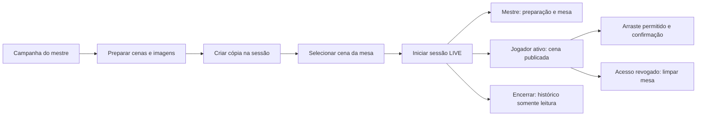

# 24 - Contratos da mesa básica

**Estado em 13 de outubro de 2026:** contratos adotados para o recorte inicial de VTT-I01. Schemas, DTOs e políticas de referência estão no pacote compartilhado; rotas, tabelas, upload de mapas e interface da mesa ainda serão implementados. Não há mudança de permissões nos recursos que já estão no site.

Referências: [plano](22-vtt-plano-de-implementacao.md), [backlog](23-vtt-backlog-e-aceite.md), [decisão 009](architecture/decisions/009-contratos-da-mesa-vtt.md), [schemas](../packages/contracts/src/vtt.ts), [políticas](../packages/contracts/src/vtt-policy.ts) e [evidências](verification/012-contratos-vtt.md). Os nomes e limites abaixo são decisões de engenharia para o Paralax, não valores exigidos pelo PDF.

## Recorte e modelo

A primeira mesa terá imagem estática ou fundo vazio, grade quadrada ou nenhuma, escala livre e tokens circulares/quadrados. O mestre atual é o proprietário da campanha. Jogador precisa de participação ACTIVE atual. Conquistas, privilégios de personalização, amizade e uma sessão/campanha pública não concedem acesso à mesa.

| Conceito | Escopo e invariantes |
| --- | --- |
| SceneTemplate | Cena de preparação da campanha; nome, descrição compartilhada, configurações e notas exclusivas do mestre; revisão própria |
| SceneAsset | Imagem validada e imutável da mesma campanha; chave física privada permanece no servidor |
| SceneInstance | Cópia de uma SceneTemplate numa sessão, com ID próprio e referência à revisão de origem; configurações/notas são copiadas, não consultadas dinamicamente na origem |
| SessionTable | Uma por sessão; cena ativa opcional e revisões por audiência; seleção aponta somente para uma SceneInstance daquela sessão/campanha |
| Token / TokenController | Token pertence a uma SceneInstance e à sua sessão/campanha; ficha opcional da mesma campanha; controle explícito e dependente de membro ativo |
| TableCommand | Identidade do ator, requestId, operação/recurso, payload normalizado e recibo; confirmação e auditoria na mesma transação da mudança |

Instanciar cria uma cópia nova, inclusive se a mesma cena já tiver outra instância na sessão. Alternar instâncias existentes conserva suas posições. Instanciar não publica: só a seleção como cena ativa em LIVE entrega aquela cópia aos jogadores. Editar a preparação da campanha não modifica as cópias. Ao encerrar, todas as instâncias da sessão ficam somente leitura; a cena ativa final continua disponível aos membros ativos. O mestre pode editar modelos para outra sessão, sem alterar a mesa encerrada.

Tokens entram em VTT-I03 e inicialmente existem nas instâncias, sem biblioteca de tokens no modelo. NPCs, barras, condições, inventário, automação, fog of war, paredes, desenho e compartilhamento com espectadores ficam nos respectivos incrementos posteriores. O raster publicado é visível inteiro: uma imagem que desenha salas secretas já revela essas salas.

## Configuração e coordenadas

UUIDs de recursos e requestId usam versão 4, normalizados para minúsculas. Os objetos de entrada são estritos: campo desconhecido é erro, inclusive identidade, dono, campanha e resultado fornecidos pelo cliente. Autoria e escopo vêm da autenticação e das relações carregadas pelo servidor.

| Campo | Contrato |
| --- | --- |
| settings.name / description | Nome de 2 a 80 caracteres; descrição compartilhada de até 2.000; trim aplicado |
| gmNotes | Texto de até 10.000 caracteres, em campo separado e exclusivo do mestre |
| width / height | Inteiros de 64 a 8.192 pixels; área máxima de 20 milhões de pixels |
| backgroundAssetId | UUID de imagem validada da mesma campanha ou null; imagem precisa ter as dimensões da cena |
| grid | `{ type: "NONE" }` ou `{ type: "SQUARE", cellSize, offsetX, offsetY }`; célula entre 8 e 1.024 pixels; offsets finitos em `[0, cellSize)` |
| scale | `{ pixelsPerUnit, unit }`; proporção finita entre 0,01 e 10.000; unidade livre de 1 a 24 caracteres, sem regra fixa de um sistema de RPG |
| Token.size / x / y | Tamanho entre 8 e 1.024 pixels; posição do centro em pixels do mapa, admite frações; o token inteiro deve caber no retângulo da cena |
| Token.kind / characterId | CHARACTER ou MARKER; UUID de ficha opcional; MARKER exige null; vínculo não concede controle nem expõe valores da ficha |
| Token.name / nameVisible | Nome de 1 a 80 caracteres; jogador recebe null quando não autorizado a ver o nome |
| Token.shape / color | CIRCLE ou SQUARE; cor hexadecimal RGB normalizada (`#8a71ff`) |
| Token.visibility | GM ou PLAYERS; GM exclui o token inteiro da projeção do jogador |
| Token.controllerIds | Até 20 UUIDs únicos, sem distinção de caixa; mestre tem controle implícito, concessões explícitas só para participantes ACTIVE da campanha |
| Revisões | Inteiros de 0 a 2.147.483.646; criação começa em 0; servidor incrementa, cliente apenas informa expectedRevision |
| Quantidade | Até 200 tokens por instância no piloto; rever após medição, sem tratar esse limite como capacidade comprovada |

Zoom, pan, dimensões da tela e seleção local não mudam coordenadas persistidas. A primeira API não força encaixe na grade: a interface pode oferecer encaixe e enviar a posição final. Movimento não verifica alcance, paredes ou regras de turno nesta etapa. Redimensionar a cena deve validar todos os tokens existentes e rejeitar uma configuração que os coloque fora do mapa; não reposicionar silenciosamente.

Exemplo completo de criação de cena:

```json
{
  "requestId": "00000000-0000-4000-8000-000000000012",
  "settings": {
    "name": "Ruínas",
    "description": "Pátio compartilhado",
    "width": 1200,
    "height": 800,
    "backgroundAssetId": null,
    "grid": { "type": "SQUARE", "cellSize": 50, "offsetX": 0, "offsetY": 0 },
    "scale": { "pixelsPerUnit": 50, "unit": "metros" }
  },
  "gmNotes": "Armadilha secreta no poço"
}
```

Os schemas validam forma e limites; não consultam banco ou decodificam arquivos. A implementação precisa verificar asset/ficha/cena da mesma campanha, dimensões reais do raster, vínculos ativos, limite de tokens e integridade das referências dentro da transação. O contexto de `vtt-policy.ts` vem de autenticação e estado atual do servidor, nunca do body ou de um papel escolhido pelo cliente.

## Matriz de acesso

| Ação | Mestre da campanha | Jogador ACTIVE | Removido, convidado pendente, terceiro ou visitante |
| --- | --- | --- | --- |
| Consultar biblioteca de modelos, notas e assets da campanha | Sim, inclusive histórico | Não | Não |
| Criar/editar modelos ou enviar imagens | Sim, campanha não ENDED/CANCELLED; PAUSED permite preparação | Não | Não |
| Consultar mesa SCHEDULED ou CANCELLED | Sim, somente o mestre | Não | Não |
| Consultar cena ativa LIVE ou ENDED | Sim, projeção GM | Sim, projeção PLAYER | Não |
| Instanciar, selecionar, editar cena; criar/editar/excluir tokens; conceder controle | SCHEDULED ou LIVE, campanha aberta; LIVE/PAUSED somente leitura | Não | Não |
| Mover token | Todas as instâncias editáveis, inclusive tokens GM | Só LIVE, campanha aberta e não PAUSED, token PLAYERS da cena ativa com concessão atual | Não |
| Consultar imagem da cena publicada | Sim | Só fundo ativo de LIVE/ENDED, pela sessão autorizada | Não |
| Editar mesa ENDED ou CANCELLED | Não | Não | Não |

A pausa acima pertence ao contrato futuro da mesa; não implementa pausa de chat, agenda ou dados, nem altera o comportamento atual desses módulos. Não acrescentar co-mestre ou espectador por inferência. Essas audiências precisam de contrato próprio antes da expansão.

Remover participante invalida consulta, download e comando seguintes, mesmo se o token ainda guardar seu ID na concessão. O token e a ficha retida ficam disponíveis ao mestre; não remover dados históricos nem transferir controle implicitamente. Uma nova concessão valida participação atual. Acesso à ficha segue seu contrato existente, separado do direito de mover um token.

## Projeções e revisões

`GET table` determina a audiência pelo servidor. O body nunca escolhe GM/PLAYER. `projectVttTable` produz uma cópia por whitelist, sem devolver a entidade persistida.

- GM: revisão GM da mesa/cena/token, notas, referência de origem, tokens visíveis e ocultos, especificação e controladores.
- PLAYER: revisão PLAYER da mesa/cena/token, configurações compartilhadas e somente tokens PLAYERS; nome autorizado, posição/aparência e canMove para aquele usuário.
- O jogador não recebe notas, referência/revisão da preparação, characterId, kind, lista de controladores, contagem/IDs de tokens secretos, chaves físicas de armazenamento ou revisão GM.
- Mesa sem seleção retorna `scene: null`. O estado vazio não lista cenas em preparação.

Mesa, instância e token têm contadores GM/PLAYER separados. Mudança apenas privada incrementa GM, sem modificar resposta/cursor PLAYER. Mudança que altera qualquer projeção de jogador incrementa PLAYER e GM nos agregados afetados; mudança de controle pode alterar canMove. Nunca usar sequência de auditoria secreta como cursor público. Ocultar um token modifica a projeção pública (remoção da lista), mas não envia o conteúdo agora secreto. Torná-lo público publica sua projeção autorizada e revisão pública.

expectedRevision de criação/edição/seleção vem do recurso alvo; movimento usa a revisão daquele token na audiência do ator. Concessões privadas e revogação sempre são revalidadas, mesmo quando não alteram a revisão pública. A seleção usa revisão da mesa; editar configurações/notas usa revisão da instância ou modelo; criar/excluir token atualiza agregados. Resposta de conflito só contém a revisão correspondente ao ator e ao recurso conhecido; nunca IDs/histórico de alterações secretas.

## API adotada para implementação

Prefixo `/api/v1`. Estas rotas são contratos futuros; não estão disponíveis na API atual. Todas exigem Bearer válido e `Cache-Control: no-store`. IDs/campanha/sessão do path são resolvidos no servidor. POST/PATCH/PUT/DELETE confirmados retornam `VttCommandReceipt`: requestId, resourceId e revision (null para asset imutável). O cliente consulta o recurso após o recibo, sem tratar posição otimista como persistida.

| Método / caminho | Entrada / saída prevista | Permissão e revisão |
| --- | --- | --- |
| GET `/campaigns/:campaignId/scenes?page=1` | `vttSceneListSchema`; `{ items: VttSceneTemplate[], total, page, pageSize: 20 }`, ordem createdAt/ID decrescente | Mestre; lista inclui preparação privada |
| POST `/campaigns/:campaignId/scenes` | `vttSceneCreateSchema`; recibo, 201 | Mestre; revisão inicial 0 |
| GET `/campaigns/:campaignId/scenes/:sceneId` | `VttSceneTemplate` | Mestre; valida campanha |
| PATCH `/campaigns/:campaignId/scenes/:sceneId` | `vttSceneUpdateSchema`; recibo, 200 | Mestre; expectedRevision do modelo |
| POST `/campaigns/:campaignId/scene-assets` | Multipart, exatamente um file e metadado `vttAssetUploadSchema`; recibo, 201 | Mestre; asset validado e imutável |
| GET `/campaigns/:campaignId/scene-assets/:assetId` | `VttAsset`, sem chave/URL de storage | Mestre; dimensões e bytes confirmados pelo servidor |
| GET `/campaigns/:campaignId/scene-assets/:assetId/content` | Bytes WebP | Mestre; verificar acesso antes de ler arquivo |
| POST `/sessions/:sessionId/table/scenes` | `vttSceneInstantiateSchema`; recibo, 201 | Mestre; sceneRevision da origem e mesma campanha; cria instância, não publica |
| GET `/sessions/:sessionId/table/scenes?page=1` | `VttGmScenePage`: resumo sem tokens/notas, mesmo envelope/página 20 | Mestre; preparação da sessão, sem baixar todos os tokens de todas as cenas |
| GET `/sessions/:sessionId/table/scenes/:sceneInstanceId` | `VttGmScene` | Mestre; escopo validado |
| PATCH `/sessions/:sessionId/table/scenes/:sceneInstanceId` | `vttSceneUpdateSchema`; recibo, 200 | Mestre; revisão GM da instância |
| PUT `/sessions/:sessionId/table/active-scene` | `vttSceneActivateSchema`; recibo, 200 | Mestre; revisão GM da mesa; instância da sessão |
| GET `/sessions/:sessionId/table` | `vttTableSchema`: GM ou PLAYER | Matriz de consulta; apenas cena ativa |
| GET `/sessions/:sessionId/table/assets/:assetId/content` | Bytes WebP do fundo ativo | Mestre ou jogador autorizado à mesa; jogador somente asset selecionado |
| POST `/sessions/:sessionId/table/scenes/:sceneInstanceId/tokens` | `vttTokenCreateSchema`; recibo, 201 | Mestre; instância editável, limites e vínculos |
| PATCH `/sessions/:sessionId/table/scenes/:sceneInstanceId/tokens/:tokenId` | `vttTokenUpdateSchema`; recibo, 200 | Mestre; substitui especificação completa, revisão GM do token |
| PATCH `/sessions/:sessionId/table/scenes/:sceneInstanceId/tokens/:tokenId/position` | `vttTokenMoveSchema`; recibo, 200 | Mestre ou controlador atual; revisão do token na audiência do ator |
| DELETE `/sessions/:sessionId/table/scenes/:sceneInstanceId/tokens/:tokenId` | Body `vttTokenDeleteSchema`; recibo, 200 | Mestre; revisão GM do token; tombstone/auditoria para retry |

VTT-I02 implementa somente cenas/assets/mesa. Tokens entram em VTT-I03. Exclusão de modelos, instâncias e assets não faz parte desta API inicial; retenção e exportação exigem regra de referências antes de disponibilizar remoção.

Exemplo de movimento permitido:

```json
{
  "requestId": "00000000-0000-4000-8000-000000000012",
  "expectedRevision": 3,
  "x": 150.25,
  "y": 200
}
```

O movimento não aceita nome, visibility, controllerIds, characterId, campaignId ou actorId. Conhecer o UUID de um token não autoriza a ação.

## Confirmação, conflito e retry

Ordem obrigatória de um comando:

1. Autenticar e validar path/body. Carregar campanha e checar acesso atual, sem consultar recibos de outra identidade/campanha.
2. Em transação, bloquear campanha primeiro, como membros/chat/dados já fazem; depois sessão, mesa, instância e token necessários, em ordem estável. Revalidar participação, estado e escopo após o bloqueio. Encerramento/remoção precisam compartilhar esse bloqueio quando a mesa for integrada.
3. Procurar requestId daquele ator na campanha/sessão. Registrar operação, recurso e payload já normalizado. Mesmo ID com outro comando/payload retorna 409 `VTT_REQUEST_ID_REUSED`.
4. Se já confirmado, devolver somente o recibo original ao ator que ainda pode consultar o escopo. Não executar de novo, nem devolver snapshot privilegiado armazenado. Retry após encerramento pode recuperar recibo; revogação de acesso nega a recuperação. Recibo não revela dados atuais de um token ocultado ou excluído.
5. Para comando novo, verificar permissão da ação, revisão e invariantes relacionais/geométricas. Aplicar mudança, revisões, auditoria e recibo atomicamente. Commit precede qualquer confirmação/evento.

O comando pendente conserva requestId e payload sob timeout/5xx/429. Reenvio não usa a revisão nova para o mesmo ID; após conflito, consultar estado e criar outro ID para uma nova intenção. O log de recibos acompanha a retenção da campanha/sessão; não expirar enquanto a API promete recuperar o comando. Desfazer completo e persistência offline pertencem a VTT-I04.

| Situação | Resposta contratada |
| --- | --- |
| Sem autenticação | 401, padrão da API |
| Sem acesso ao escopo, token oculto/alheio para o jogador, UUID de outra campanha/sessão | 404, sem confirmar existência |
| Body/path inválido, arquivo inválido, coordenadas fora do mapa, controlador inválido | 400; sem mudança parcial |
| Escopo consultável, mas estado somente leitura | 409 `VTT_TABLE_READ_ONLY` |
| Revisão divergente | 409 `VTT_REVISION_CONFLICT`, conforme schema abaixo |
| Mesmo requestId com outro payload/operação/recurso | 409 `VTT_REQUEST_ID_REUSED` |
| Arquivo excede limite | 413; antes de gravar storage |
| Tipo/frames de imagem não suportados | 415 |
| Limite de taxa | 429; conservar tentativa para retry |

```json
{
  "statusCode": 409,
  "code": "VTT_REVISION_CONFLICT",
  "message": "O token foi alterado. Atualize a mesa antes de tentar novamente.",
  "currentRevision": 4
}
```

O futuro adaptador HTTP deve preservar o envelope existente de erros (`statusCode`, `message`, `error`) quando aplicável; o conflito adota `code` e currentRevision definidos em `vttRevisionConflictSchema`. Autorização precede erros de revisão: terceiro não recebe a revisão de um recurso privado.

## Imagens privadas

Reutilizar o store Blob privado já conectado para produção e diretório privado local para desenvolvimento, com prefixo isolado `scene-assets/<campaignId>/<assetId>.webp`. O fluxo de avatar atual é público e não é uma rota de entrega de mapas. Não mudar o acesso de objetos existentes nem provisionar serviços nesta etapa.

- Upload inicial: PNG, JPEG ou WebP de um frame, no máximo 3 MiB por arquivo, 64–8.192 pixels por lado e 20 milhões de pixels decodificados. Decodificar com limite de pixels, validar formato real, rejeitar animação e normalizar para WebP sem metadados. Revalidar tamanho final até 3 MiB. A cena usa as dimensões confirmadas, sem esticar/redimensionar o arquivo silenciosamente.
- Multipart tem um arquivo e um requestId; rejeitar partes/campos extras, limitar overhead e tamanho total da requisição a 3,5 MiB. Limites devem ser configurados no parser de upload; o limite JSON atual não cobre arquivos. A Vercel documenta limite de 4,5 MB para payload de Functions, portanto esse recorte deixa margem para multipart e respostas. [Limites oficiais](https://vercel.com/docs/functions/limitations).
- A gravação é privada e imutável. Upload não publica uma imagem: referência no fundo de uma instância ativa LIVE concede leitura do raster inteiro aos participantes atuais.
- O servidor resolve o asset por UUID/escopo, verifica acesso atual, busca o Blob privado e entrega bytes com `Cache-Control: private, no-store` e `X-Content-Type-Options: nosniff`. Não aceitar URL/path físico arbitrário, expor segredo de Blob ou devolver URL pública/assinada no DTO. A Vercel oferece leitura privada via `get()` com autenticação da aplicação junto ao handler. [Private Storage](https://vercel.com/docs/vercel-blob/private-storage).
- Como o cliente usa Bearer em memória, buscar o arquivo autenticado e usar URL de objeto local. Revogar essa URL e limpar mesa/drafts em logout, troca de conta, troca de cena ou acesso revogado. Não persistir imagens privadas em service worker/cache compartilhado. Bytes já vistos por um usuário não podem ser recolhidos depois.
- Upload segue compensação: uma falha antes da confirmação não deixa asset publicado; se o banco não confirmar, remover apenas o novo objeto desse upload. Não sobrescrever assets referenciados por histórico. Substituição gera outro ID e conserva o arquivo anterior enquanto houver referências.

Antes de habilitar uploads em VTT-I02, conferir prefixo e permissão do store real, definir e medir cotas de armazenamento por campanha, custo de transferência/leitura, retenção de arquivos sem referência e rotina compensatória para falha de limpeza. VTT-D05 fica parcialmente resolvida; não criar um job que apaga assets existentes sem essa decisão. Esta etapa não testa upload/download real nem autoriza contratação.

## Sincronização e interface

O contrato é independente do transporte. Autoridade está no estado confirmado no servidor. Consulta inicial/reconexão recebe snapshot da audiência; o cliente substitui a projeção local. Eventos futuros são emitidos após commit, carregam somente projeções autorizadas e indicam ressincronização se a revisão não puder ser aplicada. Reconnect refaz autenticação/participação; presença nunca prova acesso. Rascunho/arraste otimista não confirma persistência.

Não reutilizar a sequência do chat como revisão da mesa. Não transmitir entidade GM e escondê-la por CSS. VTT-D02 continua aberta até protótipo com dois clientes medir latência de confirmação, reconexão/revogação, conflito e custo na hospedagem pretendida. VTT-D04 continua aberta até renderização e mouse/toque/teclado serem medidos em dispositivo modesto. Os contratos não alegam WebSocket ou sincronização instantânea já disponíveis.

Navegação proposta para o protótipo visual seguinte:



O protótipo precisa mostrar carregamento, erro/retry, vazio, conflito, somente leitura e revogação. O fluxo acima é uma especificação de navegação; ainda não é uma tela nem evidência de usabilidade/desempenho.

## Saída desta etapa

Schemas/DTOs, matriz, geometria e projeções por audiência estão disponíveis e têm testes executáveis. Contratos de rotas, atomicidade/retry e arquivos estão documentados para implementação. Persistência, autenticação das rotas, corrida entre encerramento/remoção/movimento, parser/Blob, performance e interação visual ainda precisam de integração/ensaio.

**Evolução posterior:** [25 - protótipo visual](25-vtt-prototipo-visual.md) entrega a navegação/estados e medição inicial de VTT-D04, com dados fictícios e sem persistência. Ensaio físico e operação/cotas/retenção de arquivos continuam pendentes. Próximo recorte de VTT-I02: migrations aditivas, API/editor de cenas e seleção persistida da mesa; tokens/sincronização ficam em VTT-I03.
